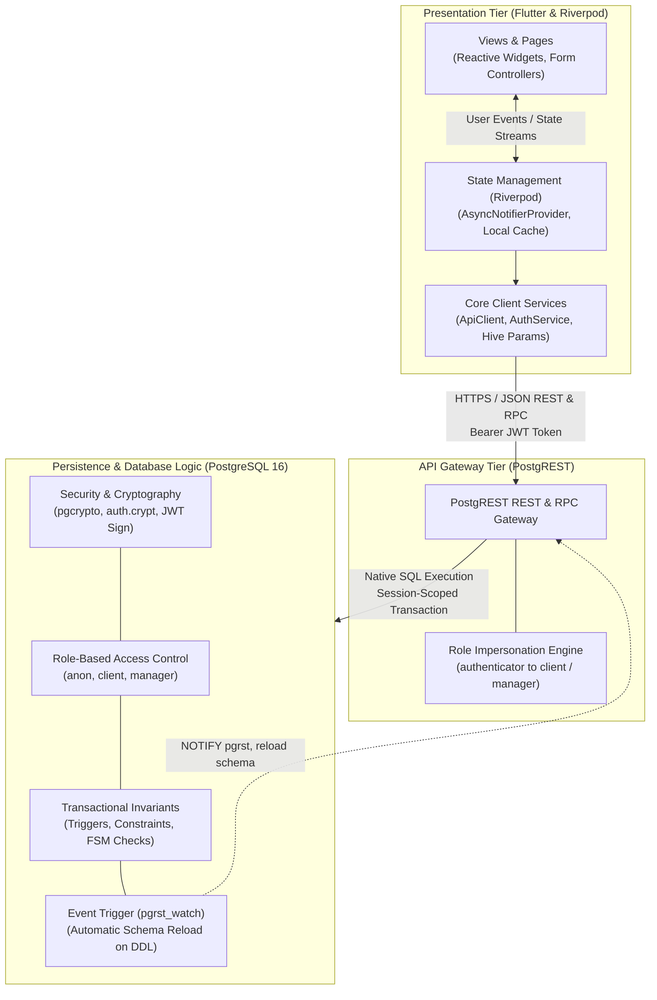
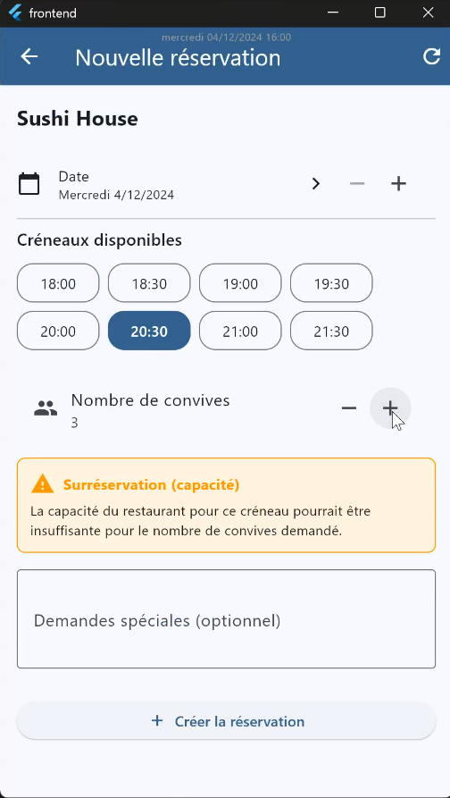
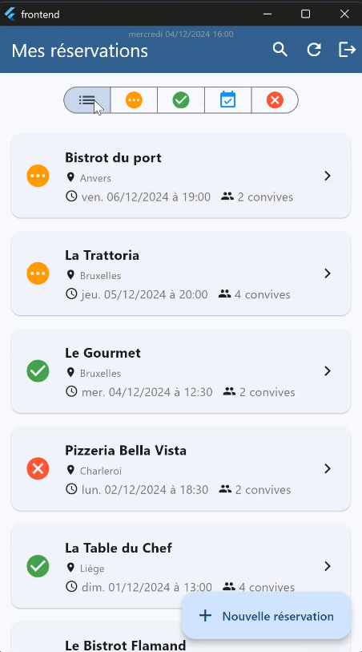
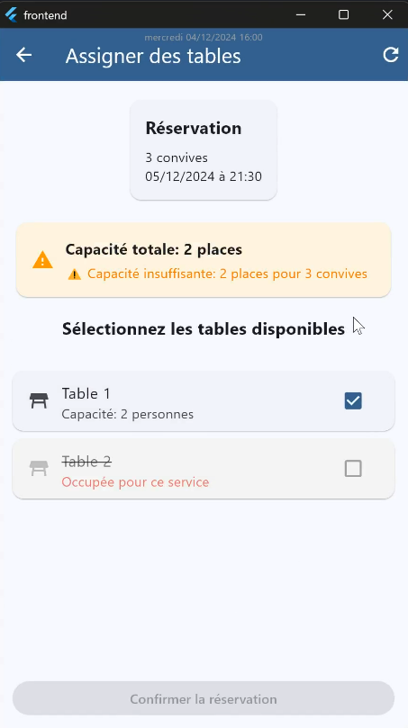

# ReserVite — Multi-Role Restaurant Reservation & Table Allocation Platform

A full-stack, cross-platform reservation and table allocation platform built on an enterprise-grade decoupled 3-tier architecture.

Instead of delegating validation and transactional consistency to an intermediate application layer or ORM, **ReserVite enforces all critical business logic, concurrency locks, state machines, and access control policies directly inside PostgreSQL**. An automated REST/JSON API is exposed through **PostgREST**, consumed by a cross-platform **Flutter** client structured with **Riverpod** for declarative, reactive state management.

---

## 📑 Table of Contents

- [Software Architecture](#-software-architecture)
  - [1. Presentation Layer (Flutter & Riverpod)](#1-presentation-layer-flutter--riverpod)
  - [2. API Gateway Tier (PostgREST)](#2-api-gateway-tier-postgrest)
  - [3. Persistence & Database Logic Layer (PostgreSQL 16)](#3-persistence--database-logic-layer-postgresql-16)
- [Database-Driven Integrity & Business Logic](#-database-driven-integrity--business-logic)
  - [1. Temporal Integrity & Slot Arithmetic](#1-temporal-integrity--slot-arithmetic-br-04-br-05-br-08-br-14)
  - [2. Multi-Table Capacity & Concurrency Locks](#2-multi-table-capacity--concurrency-locks-br-02-br-06)
  - [3. Finite State Machine & Immutability](#3-finite-state-machine--immutability-br-09-br-11-br-12)
  - [Business Rules Enforcement Matrix](#business-rules-enforcement-matrix)
- [Security & RBAC (Role-Based Access Control)](#-security--rbac-role-based-access-control)
- [Demonstration & Key User Flows](#-demonstration--key-user-flows)
  - [1. Client Booking & Dynamic Slot Generation](#1-client-booking--dynamic-slot-generation-client_bookingpng)
  - [2. Client Reservation Hub & Lifecycle Tracking](#2-client-reservation-hub--lifecycle-tracking-client_homepng)
  - [3. Manager Table Allocation & Concurrency Guard](#3-manager-table-allocation--concurrency-guard-assign_tablespng)
- [Automated Testing & Quality Assurance](#-automated-testing--quality-assurance)
  - [1. Database-Level Integration Testing](#1-database-level-integration-testing-backendtestspsql)
  - [2. API Contract & Gateway Testing](#2-api-contract--gateway-testing-backendtestshttp)
- [Team Collaboration & Contribution Matrix](#-team-collaboration--contribution-matrix)
  - [1. Collaborative Git Workflow](#1-collaborative-git-workflow)
  - [2. Responsibilities & Contribution Matrix](#2-responsibilities--contribution-matrix)
- [Authors & Academic Context](#-authors--academic-context)
- [Disclaimer & Academic Notice](#disclaimer--academic-notice)

---

## 🏛️ Software Architecture

ReserVite is built on a **Decoupled 3-Tier Architecture** that enforces transactional data integrity and multi-role access control directly at the database engine level.

The system combines a cross-platform **Flutter** client using **Riverpod** for declarative state management, a stateless **PostgREST** gateway exposing HTTP/REST and RPC endpoints, and a **PostgreSQL** relational database executing transactions, triggers, and constraint checks.

---

### 1. Presentation Layer (Flutter & Riverpod)

The client application is developed in **Flutter** (Dart 3.x) to deliver a responsive interface across Web, Desktop (macOS, Windows), and Mobile platforms from a single codebase.

* **Reactive State Management (`AsyncNotifier`)**: Data streams and UI updates are structured with Riverpod `AsyncNotifierProvider` instances (`AuthNotifier`, `ReservationsNotifier`, `TablesNotifier`). This pattern guarantees deterministic lifecycle transitions across `AsyncLoading`, `AsyncData`, and `AsyncError` states.
* **Telemetry & Debugging (`MyProviderObserver`)**: Extends Riverpod's `ProviderObserver` to track provider initialization, monitor mutations, and log errors along with their execution stack traces during development.
* **Network Client (`ApiClient`)**:
  * Resolves base URLs dynamically based on target platforms (`http://localhost:3000/rpc` for Web/Desktop/macOS and `http://10.0.2.2:3000/rpc` for Android emulators).
  * Injects active Bearer JWT session tokens into HTTP authorization headers.
* **Debounced Form Validation (`ValidatingTextEditingController`)**:
  * Handles immediate synchronous validation (syntax and regex checks) while managing asynchronous validation tasks (`is_email_available`, `is_full_name_available`).
  * Employs an internal `Debouncer` (300 ms delay) and `CancelableOperation` pipeline to cancel outdated requests while the user types, cutting unnecessary server calls.
* **Local Session Storage (`Hive`)**: Lightweight key-value store (`Params`) used to persist user tokens across application restarts.

---

### 2. API Gateway Tier (PostgREST)

**PostgREST** acts as the communication bridge between the Flutter client and the database engine.

* **Declarative Routing**: Directly generates OpenAPI/REST endpoints and Remote Procedure Calls (`/rpc/login`, `/rpc/confirm_reservation`, `/rpc/get_available_slots`) based on PostgreSQL schemas and stored functions.
* **Role Impersonation**:
  1. The client transmits an `Authorization: Bearer <JWT>` header with each request.
  2. PostgREST verifies the token signature against the server secret key (`auth.sign`).
  3. PostgREST assumes the database role embedded in the token (`client` or `manager`), executes queries within that session scope, and resets role privileges once execution completes.
* **Dynamic Schema Synchronization (`pgrst_watch`)**:
  * An automated PostgreSQL `EVENT TRIGGER` (`ON ddl_command_end`) issues `NOTIFY pgrst, 'reload schema'`.
  * Schema migrations and stored procedure updates refresh PostgREST's internal schema cache without requiring server reboots.

---

### 3. Persistence & Database Logic Layer (PostgreSQL 16)

The database layer serves as the central authority for business rules, concurrency management, and data consistency.

* **Authentication & Cryptography (`auth` schema)**:
  * Passwords are encrypted before write operations using Blowfish crypt hashing (`auth.crypt` with `auth.gen_salt('bf')`) through an `AFTER INSERT OR UPDATE` trigger on the `users` table.
  * Security helpers (`auth.id()`, `auth.role()`, `auth.email()`) decode authenticated session claims directly from `current_setting('request.jwt.claims', true)`.
* **Reservation Lifecycle State Machine (`BR-09`, `BR-11`)**:
  * Regulated via `check_reservation_status_cycle_fct()` to restrict valid transitions to `pending` &rarr; `confirmed` &rarr; `completed` (or cancellation).
  * Reverting a booking from `confirmed` to `pending` is only allowed when the reservation date is set in the future relative to `system_time`.
  * Finalized bookings (`completed`, `cancelled`) are immutable (`BR-11`).
* **Concurrency & Deferred Invariant Checks (`BR-02`, `BR-06`, `BR-12`)**:
  * Multi-table operations run within isolated ACID transactions.
  * Complex invariants, such as total seating capacity verification and double-booking prevention, are configured as `CONSTRAINT TRIGGER ... DEFERRABLE INITIALLY DEFERRED`. These triggers evaluate consistency at transaction `COMMIT`, preventing partial or invalid state commits.
* **Time Slot Modular Arithmetic (`BR-05`, `BR-08`)**:
  * Booking start times and operating service schedules are validated against configured slot intervals (10, 15, 20, 30, or 60 minutes) using SQL modulo arithmetic.
  
---

## 🛡️ Database-Driven Integrity & Business Logic

ReserVite relies on a declarative and procedural relational design where 100% of the operational rules are enforced by PostgreSQL check constraints, functions, and triggers. Invalid states are rejected at the database level regardless of API-level access.

### 1. Temporal Integrity & Slot Arithmetic (`BR-04`, `BR-05`, `BR-08`, `BR-14`)
* **Slot Alignment (`BR-05`)**: Booking start times must strictly align with the restaurant's operational slot duration (10, 15, 20, 30, or 60 minutes). The total elapsed minutes from midnight modulo the venue slot duration must equal zero.
* **Service Boundaries (`BR-04`)**: Ensures a non-cancelled booking falls strictly between the `start_time` and `end_time` of an active service on that ISO day of the week.
* **Service Schedule Alignment (`BR-08`)**: Services themselves must start and end at minute marks aligned with the restaurant's slot duration.
* **Temporal Guard (`BR-14`)**: Rejects creating bookings in the past relative to the simulated system clock (`system_time`).

### 2. Multi-Table Capacity & Concurrency Locks (`BR-02`, `BR-06`)
* **Overbooking Guard (`BR-02`)**: Confirmed or completed reservations require assigned tables whose cumulative capacity is greater than or equal to the requested number of guests. Enforced across table deletions, guest count edits, and table unassignments using a deferrable constraint trigger.
* **Anti-Double-Booking Guard (`BR-06`)**: Prevents assigning the same table to two distinct active bookings (`confirmed` or `completed`) during the same service window on the same calendar day. Handled via a cross-table join check executed on `COMMIT` (`DEFERRABLE INITIALLY DEFERRED`).

### 3. Finite State Machine & Immutability (`BR-09`, `BR-11`, `BR-12`)
* **Reservation Lifecycle (`BR-09`)**: Initial state is strictly `pending`. Authorized forward transitions:
  * `pending` $\rightarrow$ `confirmed` | `cancelled`
  * `confirmed` $\rightarrow$ `completed` | `cancelled`
  * `confirmed` $\rightarrow$ `pending` (*allowed only if the booking datetime is strictly in the future*).
* **State Immutability (`BR-11`)**: Terminal records (`completed`, `cancelled`) are frozen; updates to dates, guest counts, or requests trigger an immediate database error.
* **Table Isolation (`BR-12`)**: Tables cannot be attached to `pending` or `cancelled` reservations.

### Business Rules Enforcement Matrix

<strong>🔍 Click to expand the full Business Rules Enforcement Matrix (BR-01 to BR-14)</strong>

| Rule ID | Invariant Scope | SQL Mechanism |
| :--- | :--- | :--- |
| **BR-01** | Client Reservation Ownership | `BEFORE INSERT` trigger on `reservations` |
| **BR-02** | Capacity vs Guests | `AFTER INSERT/UPDATE/DELETE` + Deferrable constraint trigger |
| **BR-03** | Restaurant-Table Coherence | `BEFORE INSERT` trigger on `reservation_tables` |
| **BR-04** | Booking inside Service Hours | Cross-table verification trigger on `reservations` & `services` |
| **BR-05** | Time Slot Alignment | Arithmetic modulo trigger on reservation timestamp |
| **BR-06** | Double-Booking Prevention | Cross-table join trigger with `DEFERRED` execution |
| **BR-07** | Service Schedule Overlap | `BEFORE INSERT/UPDATE` trigger preventing overlapping services |
| **BR-08** | Service / Slot Alignment | Cross-validation trigger on service start/end times |
| **BR-09** | Status Cycle Transition | `BEFORE INSERT/UPDATE` finite state machine trigger |
| **BR-10** | Manager Minimum Requirement | Deferred constraint trigger ensuring each restaurant has at least 1 manager |
| **BR-11** | Immutability of Final States | `BEFORE UPDATE` trigger on terminal states (`completed`, `cancelled`) |
| **BR-12** | Table Isolation | Rejects table assignments for `pending` or `cancelled` bookings |
| **BR-13** | Anti-Hoarding Booking Check | Multi-booking block per user, date, and service window |
| **BR-14** | Anti-Retroactive Booking | `BEFORE INSERT` trigger comparing against `system_time` |

---

## 🔐 Security & RBAC (Role-Based Access Control)

1. **Authentication via Cryptographic Stored Procedures**:
   * The `login(email, password)` function verifies credentials against passwords hashed with Blowfish salting (`auth.crypt` via `pgcrypto`).
   * Returns an RFC-compliant JWT signed with a secret key containing session claims (`role`, `user_id`, `sub`, and expiration `exp`).
2. **PostgREST Session Impersonation**:
   * Requests include `Authorization: Bearer <token>`. PostgREST validates the signature and assumes the database role specified in claims (`client` or `manager`).
   * Session helpers `auth.id()`, `auth.role()`, and `auth.email()` read dynamically from `current_setting('request.jwt.claims', true)`.
3. **Trigger-Based Encryption**:
   * Plain-text passwords submitted during signup are intercepted by an `AFTER INSERT OR UPDATE` trigger (`auth.encrypt_pass`), preventing plain credentials from reaching raw storage.

--- 

## 📸 Demonstration & Key User Flows

The interface highlights the multi-role capabilities of the platform while providing immediate visual feedback backed by database constraints.

  
  &nbsp;
  
  &nbsp;
  

### 1. Client Booking & Dynamic Slot Generation (`client_booking.png`)
* **Slot Alignment & Filtering (`BR-04`, `BR-05`)**: Available times are generated on the fly by evaluating active service windows for the target date against the restaurant's operational slot duration (e.g., 30-minute intervals).
* **Live Capacity Warning**: Triggers immediate contextual feedback when guest count approaches or exceeds the restaurant's capacity, assisting users before submitting.

### 2. Client Reservation Hub & Lifecycle Tracking (`client_home.png`)
* **Real-Time Status Indicators**: Categorizes bookings across active lifecycle states (`pending`, `confirmed`, `completed`, `cancelled`).
* **State Machine Guard (`BR-09`, `BR-11`)**: Visual chips reflect database state; terminal bookings (`completed`, `cancelled`) are locked from further editing.

### 3. Manager Table Allocation & Concurrency Guard (`assign_tables.png`)
* **Live Seat Aggregation (`BR-02`)**: Dynamically computes total seating capacity as the manager selects tables, asserting that total capacity matches or exceeds guest count. The confirmation button remains locked if total capacity is insufficient for the party size.
* **Double-Booking Shield (`BR-06`)**: Tables already occupied during the requested service window appear greyed out and struck-through (`Occupée pour ce service`), eliminating conflicting assignments at the UI level prior to database transaction validation.

---

## 🧪 Automated Testing & Quality Assurance

ReserVite applies a two-tiered testing strategy: isolated transactional integration tests directly within PostgreSQL, and HTTP contract tests validating PostgREST API routes and role-based permissions.

---

### 1. Database-Level Integration Testing (`backend/tests/*.sql`)

All database test scripts run inside isolated transactions terminated with an explicit `ROLLBACK`, guaranteeing zero residual test data.

* **Negative Testing Harness (`should_fail`)**: Business invariants and constraint triggers are asserted using `should_fail()`, ensuring illegal operations raise expected PostgreSQL exceptions (e.g., `'unique_violation'`, `'raise_exception'`).
* **Session Impersonation (`test_02_impersonation.sql`)**: Test helpers (`auth.login_for_test`, `auth.login_anonymously_for_test`) verify dynamic role switching and JWT claims decoding (`auth.id()`, `auth.role()`) directly within transaction scopes.

| Test File Scope | Target Focus & Invariants Tested |
| :--- | :--- |
| `test_01_login.sql` | Cryptographic password matching via `auth.crypt` and invalid credential rejection |
| `test_02_impersonation.sql` | Session role impersonation and dynamic JWT claim extraction |
| `test_03_reset_database.sql` | Cascade schema reset, sequences re-indexing, and deterministic re-seeding |
| `test_04.00_br_*` to `test_04.14_br_*` | Full business invariant suite: capacity checks (`BR-02`), double-booking prevention (`BR-06`), slot modulos (`BR-05`), lifecycle FSM (`BR-09`, `BR-11`), and anti-past guards (`BR-14`) |

---

### 2. API Contract & Gateway Testing (`backend/tests/**/*.http`)

REST and RPC endpoints are verified across active role scopes using structured HTTP files:

* **Authentication & Credentials**: Verifies JWT issuance on `/rpc/login` and account creation via `/rpc/signup`.
* **RBAC & Tenancy Isolation**: Asserts that client tokens cannot trigger manager endpoints (such as `/rpc/complete_reservation`) and prevents managers from modifying venues they do not supervise.
* **Core Endpoints Tested**: Reservation lifecycle (`/rpc/confirm_reservation`, `/rpc/cancel_reservation`), real-time availability (`/rpc/get_available_slots`), and table occupancy queries (`/rpc/is_occupee`).

---

## 👥 Team Collaboration & Contribution Matrix

ReserVite was developed collaboratively by a team of three software engineering students based on a provided architectural baseline (PostgreSQL init, PostgREST configuration, and JWT security scaffolding).

### 1. Collaborative Git Workflow
* **Branching Strategy**: Development was coordinated using Git feature branching (`git-flow`), isolating functional increments (`feat/...`, `fix/...`, `refactor/...`) before integration into a central `develop` staging branch.
* **Semantic Commits**: Adherence to Conventional Commit guidelines to ensure clear commit histories and traceability across schema migrations, backend endpoints, and Flutter widgets.
* **Continuous Integration**: Peer reviews and conflict resolution sessions on `develop` before cutting milestone deliveries.

### 2. Responsibilities & Contribution Matrix

| Team Member | Database & Backend (PostgreSQL / PL-pgSQL) | Frontend & Application State (Flutter / Riverpod) |
| :--- | :--- | :--- |
| **Aymen Jeridi** | • Business Invariants: **BR-01** (client check), **BR-04** (service hours), **BR-08** (slot alignment), **BR-09** (reservation status cycle), **BR-12** (table isolation), **BR-13** (anti-hoarding), composite keys immutability trigger. • Reservation RPC functions (`get_reservations`, `get_available_slots`, `save_reservation`, `confirm_reservation`). • Automated SQL & HTTP test suites for assigned business rules. | • Reservation Features: Booking form, reactive slot picker, guest capacity warnings, status cycle details views (client & manager). • Table Management: Complete CRUDL (`tables_provider`, `edit_table_page`), `SplayTreeSet` sorting by capacity/number, asynchronous table number validation. • Service Management: Deletion checks against active bookings, day-based service lists (`services_per_day_provider`). • Manager Navigation: Persistent manager hub (`manager_home_page`). |
| **Constantin Gabor** | • Business Invariants: **BR-02** (table capacity vs guests), **BR-05** (booking slot modulo), **BR-07** (service schedule overlap), **BR-10** (minimum 1 manager). • Restaurant schema constraints (phone format, rating, price range, slot duration). • Restaurant search & retrieval endpoints (`get_restaurant`, `get_restaurants`). • Associated SQL & HTTP test scripts. | • Restaurant Discovery: `search_restaurants_page`, `my_restaurants_page`, and `restaurant_details_page`. • Search persistence via `searchBarProvider` and `filtered_restaurants_provider`. • Time-travel integration: UI date/time picker (`pickDateTime`) wired to `applicationTimeProvider`. • Booking actions: cancellation and completion dialogues (`btn_annulation_widget`). |
| **Anass Adahchour** | • Business Invariants: **BR-03** (table-restaurant matching), **BR-06** (double-booking prevention via deferred triggers), **BR-11** (terminal state lock), **BR-14** (anti-past booking guard). • User endpoints: `signup`, availability RPCs (`is_email_available`, `is_full_name_available`), role verification (`isClient`, `isManager`). • Associated SQL & HTTP test scripts. | • Authentication Module: Login and registration flow (`login_page`, `signup_page`), `AuthService`, and `authProvider`. • Form Validation: Custom `ValidatingTextEditingController` with debounced asynchronous uniqueness validation. • Table Assignment UI: Initial scaffolding for manager table allocation (`assign_tables_page`, `selected_tables_provider`). |

--- 

## 👨‍💻 Authors & Academic Context

This repository is a **personal portfolio showcase and mirror** of the original team project developed on Bitbucket for the **Database Development Project (PRBD - Projet de développement SGBD)** course at **EPFC** (Brussels, Belgium).

* **Aymen Jeridi** — *Repository maintainer*
* **Constantin Gabor** — *Academic co-contributor*
* **Anass Adahchour** — *Academic co-contributor*

> **Note on Repository & Collaboration**: While the underlying codebase was built in a 3-person team, this repository serves as my individual technical showcase. The structural documentation, architecture diagrams, and comprehensive README were prepared independently to demonstrate the system's design and technical depth for my final-year internship portfolio.

---

## ⚠️ Disclaimer & Academic Notice

**Educational Purpose Only**: This software project is an academic prototype developed exclusively for coursework evaluation, architectural demonstration, and pedagogical assessment. It is **not intended for commercial deployment or production environments**.

* **Security Keys & Passwords**: Any secrets, cryptographic salts, and tokens present in repository scripts are strictly reserved for local development, grading benchmarks, and unit testing environments.
* **Demonstration Data**: All venue information, client records, and simulated reservations in the dataset are fictional mock fixtures created solely to demonstrate database consistency and user interface workflows.